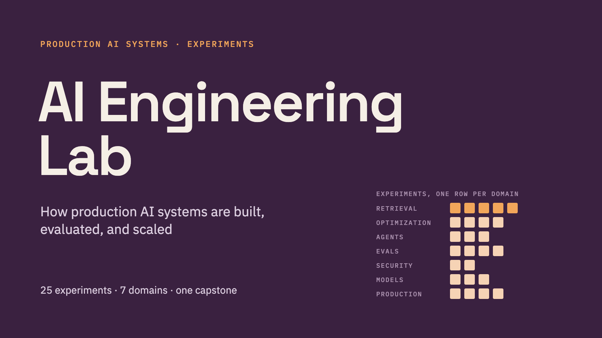

# ai-engineering-lab



Experiments, system designs, and engineering notes on how production AI systems are built, optimized, evaluated, and scaled.

Not every experiment needs code. Some are implementations, some are design documents, and some look into why an approach works or fails. Every one of them should explain the decision behind it.

## How it fits together

The 25 experiments all improve one system: a production AI assistant in [`capstone/`](capstone/production-ai-assistant/).

```
User / chat interface          streaming, SSE, conversation management     (22, 25)
API gateway & security         PII redaction, prompt injection, rate limits (17, 18)
Agent orchestrator             tool calling, memory, loop detection         (10–12)
Retrieval                      BM25, dense, reranking, chunking             (01–05)
Optimization                   semantic cache, model routing, cost          (06–09)
Model serving                  batching, KV cache, quantization, LoRA       (19–21)
───────────────────────────────────────────────────────────────────────────
Cross-cutting: evals & observability  tracing, hallucinations, judges,
                                      prompt versioning                     (13–16, 23, 24)
```

Experiment 04 builds the retrieval component. Experiment 05 adds reranking to that same component. Experiment 08 measures what caching does to its cost and quality.

## Layout

| Domain | Build | Reason through |
|---|---|---|
| [01 Retrieval](01-retrieval/) | BM25, dense, hybrid search, reranking | RAG for 10M documents |
| [02 Optimization](02-optimization/) | Semantic cache, model router | 70% cost reduction, TTFT bottlenecks |
| [03 Agents](03-agents/) | Tool calling, memory, loop detection | Agent reliability architecture |
| [04 Reliability & evals](04-reliability-and-evals/) | Eval harness, structured outputs, judge | Hallucination mitigation |
| [05 Security](05-security/) | PII redaction, injection test suite | Trust boundaries, permissions |
| [06 Model engineering](06-model-engineering/) | LoRA experiment, inference benchmarks | Fine-tuning vs RAG |
| [07 Production systems](07-production-systems/) | SSE streaming, tracing, prompt versioning | ChatGPT for 1M daily users |

Other folders:

- `shared/`: code that two or more experiments use (`llm`, `retrieval`, `datasets`, `evaluation`, `observability`).
- `templates/EXPERIMENT_README.md`: the nine-section template every experiment starts from.
- `tests/`: repo-level checks. Experiment tests go in `<experiment>/tests/`.
- `data/`, `results/`: local only, ignored by git.

Progress lives in [ROADMAP.md](ROADMAP.md).

## Inside an experiment

Each experiment starts with only a `README.md`. Add the other files when you need them:

```
04-search-strategies/
├── README.md        problem, reasoning, trade-offs
├── design.md        architecture, if needed
├── experiment.py    implementation, optional
├── results.md       findings and measurements
├── tests/           validation, optional
└── references.md    papers, articles, resources
```

Write sections 1–4 of the README (problem, first principles, design, trade-offs) yourself before asking a coding agent to implement anything. Agents can challenge the design, generate test cases, and write code after that.

## Setup

Requires [uv](https://docs.astral.sh/uv/) and Python 3.11+.

```bash
uv sync                      # create .venv with shared/ installed in editable mode
cp .env.example .env         # add only the keys you use
make test                    # layout checks + any experiment tests
```

Experiments import shared code with `from shared.llm import ...`. Add a domain's dependencies under `[project.optional-dependencies]` in `pyproject.toml` and install them with `uv sync --extra retrieval`.

If an experiment needs heavy or conflicting dependencies (vLLM, a training stack), give it its own `pyproject.toml` and `.venv` inside its folder so it stays out of the root environment.

## Working on experiments in parallel

Use one git worktree and one branch per experiment so separate sessions do not touch each other:

```bash
git worktree add ../lab-04 -b exp/04-search-strategies
git worktree add ../lab-12 -b exp/12-agent-memory
```

Keep each branch inside its own experiment folder. Changes to `shared/` go in a separate small branch so two experiments do not edit it at the same time. Update `ROADMAP.md` when you merge.
